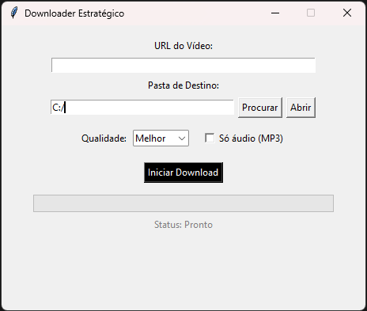

# Downloader Estratégico

Aplicativo de desktop para Windows que baixa vídeos e áudios a partir de um link, com uma interface simples feita em Tkinter e o [yt-dlp](https://github.com/yt-dlp/yt-dlp) por trás.



## O que ele faz

- Baixa vídeo em MP4 ou só o áudio em MP3
- Permite escolher a qualidade: Melhor, 1080p, 720p ou 480p
- Mostra barra de progresso durante o download
- Lembra a última pasta de destino usada
- Atualiza o yt-dlp sozinho, em segundo plano, no máximo uma vez por dia
- Abre sem janela de terminal
- Traduz os erros mais comuns para mensagens simples e guarda o erro técnico completo em `downloader.log`
- Avisa quando Deno ou FFmpeg não estão instalados

## Requisitos

- Windows 10 ou 11
- Python 3.10 ou superior
- [Deno](https://deno.com), necessário para o yt-dlp ler os formatos do YouTube
- [FFmpeg](https://ffmpeg.org), opcional, mas necessário para qualidade acima do padrão e para converter em MP3

Instalação dos dois pelo terminal:

```
winget install DenoLand.Deno
winget install Gyan.FFmpeg
```

## Instalação

```
git clone https://github.com/caducruzpy/downloader.git
cd downloader
python -m venv .venv
.venv\Scripts\pip install -r requirements.txt
```

## Como usar

1. Dê dois cliques em `iniciar.vbs`
2. Cole o link do vídeo
3. Escolha a pasta de destino, a qualidade e se quer só o áudio
4. Clique em **Iniciar Download**

O arquivo `iniciar.vbs` espera que o ambiente virtual se chame `.venv`, como no passo de instalação.

## Estrutura do projeto

```
downloader/
  interface.py       tela e eventos (Tkinter)
  downloader.py      lógica de download, atualização e tradução de erros
  iniciar.vbs        abre o programa sem janela de terminal
  requirements.txt   dependências
```

## Cookies (opcional)

Para vídeos com restrição de idade ou que exigem login, coloque um arquivo `cookies.txt` na pasta do projeto. Ele só é usado se existir.

Nunca envie esse arquivo para o GitHub, porque ele dá acesso à sua conta. O `.gitignore` do projeto já o ignora.

## Limitações conhecidas

- Funciona apenas no Windows (usa `.vbs` e `os.startfile`)
- Quando o vídeo e o áudio vêm separados, a barra de progresso chega a 100% duas vezes
- A atualização automática depende do `pip`, então não funcionaria se o projeto virasse um `.exe`
- Deno e FFmpeg precisam ser instalados à parte

## Aviso

Projeto de estudo, para uso pessoal. Baixe apenas conteúdo que você tem direito de baixar e respeite os termos de uso das plataformas e os direitos autorais.

## Por que fiz este projeto

Comecei com um script curto que quebrou com o erro `Requested format is not available`. Investigando, descobri que o seletor de formato que eu usava já não servia para o YouTube e que o yt-dlp agora precisa de um runtime de JavaScript. Depois da correção, transformei o script em um programa mais completo, com interface, tratamento de erros e log.